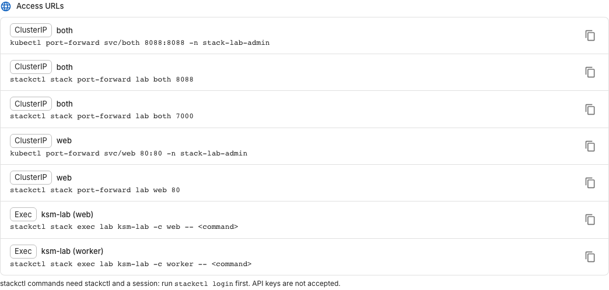

# K8s Stack Manager

**Self-service environments for multi-service Helm applications, on your own Kubernetes clusters.**

Developers start a full copy of a stack (every chart, on their own branch, with their own values) from a template, with one click or one command. Platform teams keep control with roles, quotas, chart allowlists, time limits and an audit log. Developers need no kubeconfig and no access to the cluster. K8s Stack Manager is open source (MIT) and self-hosted.

- **Per-developer stacks from templates.** Branches and value overrides for each chart, deploy preview, rollback, and comparison of two stacks.
- **No cluster access needed.** Deploy, status, logs, port-forward and exec go through the API, with role checks and an audit log.
- **Guardrails.** Roles, namespace-scoped RBAC, resource quotas, a chart source allowlist, time to live (TTL) and cleanup policies.
- **Extensible without a fork.** HTTP hooks and actions for database refreshes, policy gates or chat notifications.
- **Web UI and CLI.** [stackctl](https://github.com/omattsson/stackctl) drives every workflow, also in scripts and CI.

How it works: a **stack definition** is a collection of Helm charts with their configuration. A **stack instance** is a per-developer copy of a definition with its own branch and value overrides. Teams publish definitions as **templates**, and developers start instances from them.

Release notes and upgrade notes: [Releases](https://github.com/omattsson/k8s-stack-manager/releases).

## Getting Started

### Try it on your machine

With Docker, [kind](https://kind.sigs.k8s.io/), kubectl, Helm and [stackctl](https://github.com/omattsson/stackctl) installed, one command creates a kind cluster, installs the application and deploys a first stack (about 5 minutes):

```bash
git clone https://github.com/omattsson/k8s-stack-manager.git && cd k8s-stack-manager
make demo        # then open http://localhost:8080
make demo-down   # delete the demo cluster
```

The demo uses its own kind cluster (`kind-ksm-demo`) and its own stackctl configuration, so your other contexts stay as they are. See [scripts/demo.sh](scripts/demo.sh).

### Install on your cluster

Deploy the application to your cluster and create your first stack in about 10 minutes.

```bash
# Install the CLI
brew install --cask omattsson/tap/stackctl

# Add the Helm repo
helm repo add k8s-stack-manager https://omattsson.github.io/k8s-stack-manager
helm repo update

# Deploy to your cluster (see docs/getting-started.md for the secrets setup)
helm install stack-manager k8s-stack-manager/k8s-stack-manager \
  --namespace stack-manager --create-namespace \
  --values stack-manager-values.yaml
```

Read the [Getting Started guide](docs/getting-started.md) for the next steps. It shows how to configure stackctl, register a cluster, import the [starter definitions](examples/starter-templates/), and deploy your first stack.

Note: If you do not need the web UI, go to the [Headless / API-only deployment](docs/deployment.md#headless--api-only-deployment) section. stackctl drives every workflow.

## Features

### Dashboard: Stack Instance Management

Use the dashboard to view, search, and manage all your stack instances. You can:

- Filter the list by status: `draft`, `deploying`, `stabilizing`, `running`, `partial`, `stopped`, or `error`.
- Mark favorites with a star and see the recently used stacks.
- Select instances and deploy, stop, clean, or delete up to 50 of them in one request. This needs the `devops` or `admin` role.


### Port-forward and exec

Reach the services and the containers of a stack without a kubeconfig or access to the cluster. stackctl connects through the backend, and the backend checks your access to the stack.

```bash
# Forward a local port to a service of the stack
stackctl stack port-forward my-stack mysql 3306

# Run one command in a container of a chart
stackctl stack exec my-stack backend -c php -- bin/console cache:clear
```

The stack page shows these commands, ready to copy. It lists exec commands only for the containers that exec accepts. Both features are off by default: an admin turns them on for the server and for each cluster. Only the owner of the stack, `devops` and `admin` users can use them, with a login session (`stackctl login`). They need k8s-stack-manager v0.15.0 and stackctl v0.10.0 or later. See [Port-forward](WIKI.md#port-forward), [Exec](WIKI.md#exec) and the [security model](docs/security.md).



### Template Gallery

Browse reusable stack templates. Filter them by category: Web, API, Data, Infrastructure, or Other. Each template has a description and a version.

- **Quick Deploy** creates a new instance from a template and deploys it with one click.
- Users with the `devops` or `admin` role create templates and publish them. A published template is a snapshot (a version). Users always get the latest snapshot.


### Stack Definitions

A stack definition describes a multi-chart application. It has Helm chart configurations, a default branch, and value templates. You can import and export a definition as a JSON bundle.

Users with the `user` role get definitions from templates. Users with the `devops` or `admin` role also create and import definitions (see [Roles and security model](#roles-and-security-model)).


### Analytics Dashboard

The analytics page shows the number of templates, definitions, instances, running instances, deployments, and users. A table shows the deployments and the success rate of each template. Users with the `devops` or `admin` role can open the page. Only the `admin` role gets the per-user statistics.


### Audit Log

The audit log records every change that a user makes through the API: creates, updates, deletes, and operations such as deploy, stop, or role change. Filter the log by user ID, entity type, entity ID, action, and date range.

Only `devops` and `admin` users can read the audit log. Only `admin` users can export it.


### User Profile and API Keys

On the profile page, you manage your account, create API keys for CI/CD automation, and set notification preferences for each event type.


### Additional Features

- **Multi-cluster support.** Register more than one Kubernetes cluster. Kubeconfig data is encrypted at rest with AES-GCM (Advanced Encryption Standard, Galois/Counter Mode). A cluster can also use the service account of the backend (`use_in_cluster`). The application monitors the health and the resource use of each cluster.
- **Git provider integration.** The application lists branches from Azure DevOps, GitHub, and GitLab repositories (`gitlab.com`, or the origin of `GITLAB_BASE_URL`). You can set a branch for each chart.
- **Helm values deep merge.** Chart defaults merge with instance overrides. The application replaces template variables (`{{.Branch}}`, `{{.Namespace}}`, `{{.InstanceName}}`, `{{.StackName}}`, `{{.Owner}}`) in the values.
- **Deploy preview and rollback.** See the merged values before you deploy. Roll back one revision, or roll back to the values of an earlier successful deploy.
- **Resource quotas.** Set a ResourceQuota and a LimitRange for the stack namespaces of a cluster. You can set an override for one instance.
- **Cleanup policies.** Run cron-based actions (stop, clean, delete) on instances that match a condition.
- **TTL auto-expiry.** Set a time to live (TTL) on an instance. A background worker stops the instance when the TTL ends.
- **Real-time updates.** WebSocket messages send deployment status changes to all connected clients.
- **Role-based access control (RBAC).** The roles are `admin`, `devops`, and `user`. Authentication uses JSON Web Tokens (JWT), API keys, and optional OpenID Connect (OIDC) single sign-on (SSO).
- **Notifications.** Users get in-app notifications for deploy, stop, and clean events. `devops` and `admin` users can send events to webhook channels.
- **Instance comparison.** Compare two instances side by side, with the merged Helm values of each chart.
- **Shared values.** Set Helm values for a whole cluster. The application merges them by priority before the instance values.
- **Branding.** Set the product name, the logo, and the favicon (see [Branding](WIKI.md#branding)).
- **Dark mode.** The UI has a light theme and a dark theme.

### Extending: bring your own operations

The core application contains no organization-specific logic. You add database refreshes, CMDB sync, policy gates, snapshots, or chat notifications without a fork. You write each of them as a small service outside of the application, in any language.

There are two mechanisms:

- **Event hooks.** The application sends HTTP POST requests to subscribers on lifecycle events (`pre-deploy`, `post-instance-create`, and others). A subscriber with `failure_policy: fail` can stop an operation, for example to enforce a policy.
- **Actions.** `POST /api/v1/stack-instances/:id/actions/:name` sends a request to a subscriber that you register. The application returns the answer of the subscriber to the caller. stackctl can show actions as subcommands through [plugin discovery](https://github.com/omattsson/stackctl/blob/main/EXTENDING.md).
- **Per-team extensions.** `applies_to` limits an action or an event hook to some templates, template categories, definitions or clusters, so each team's stacks get their own extensions (see [EXTENDING.md](EXTENDING.md#per-team-hooks-and-actions)).

Both mechanisms use plain HTTP with HMAC (hash-based message authentication code) signing. See the examples in Python ([backend/examples/webhook-handler-python/](backend/examples/webhook-handler-python/)) and in Go ([backend/examples/webhook-handler/](backend/examples/webhook-handler/)).

Read [EXTENDING.md](EXTENDING.md) for the tutorial, the event reference, the action contract, and the security notes.

## How it compares

| If you use | K8s Stack Manager |
|---|---|
| Tilt, Skaffold or Garden for the inner development loop | Those tools run from the developer's machine against a cluster that the developer can access. K8s Stack Manager runs shared, per-developer stacks on central clusters, and developers need no cluster access. Both work together. |
| Argo CD or Flux pull request environments | GitOps creates environments from Git events. K8s Stack Manager starts stacks on demand from a template, with a branch and values for each chart, a TTL and quotas. Keep GitOps for your shared environments. |
| vCluster | A virtual cluster per team. K8s Stack Manager gives each stack a namespace with guardrails, without extra control planes. |
| Backstage | A developer portal and catalog. K8s Stack Manager deploys and operates the stacks; link to it from your portal. |
| Hosted preview environment services | K8s Stack Manager is self-hosted and MIT licensed: your clusters and your data, with no per-seat price. |

## Roles and security model

The application has three roles. Each role includes the rights of the roles below it: `admin` includes `devops`, and `devops` includes `user`.

| Role | Main rights |
|---|---|
| `user` | Use templates (Use Template, Quick Deploy). Create instances. Deploy, stop, clean, and delete own instances. Change the names, values, and branches of own definitions. |
| `devops` | Everything of `user`. Create templates. Change, publish, and delete own templates (an `admin` can do this for all templates). Create, import, and export definitions, and add or remove charts. Operate all instances, and use bulk operations. Read the audit log, analytics, and cluster health. Manage notification channels. |
| `admin` | Everything of `devops`. Manage clusters, quotas, shared values, users, API keys of other users, cleanup policies, and orphaned namespaces. Export the audit log. |

See the [security model](docs/security.md) for the security controls: instance and definition access, the chart source allowlist, namespace-scoped RBAC, port-forward and exec, sessions and tokens, secrets at rest, and HTTP hardening.

## Documentation

| Document | Contents |
|---|---|
| [Getting Started](docs/getting-started.md) | Install the application, register a cluster, and deploy the first stack |
| [Deployment](docs/deployment.md) | Helm chart, its security settings, External Secrets, headless (API-only) installations |
| [Configuration](docs/configuration.md) | Environment variables, GitHub and GitLab authentication |
| [Security model](docs/security.md) | Security controls of the application |
| [API](docs/api.md) | Route groups of the REST API |
| [Development](docs/development.md) | Local setup, `make` targets, tests, project structure, architecture overview |
| [WIKI.md](WIKI.md) | Concepts and reference: templates, definitions, instances, permissions, sessions, port-forward, exec, branding, troubleshooting |
| [ARCHITECTURE.md](ARCHITECTURE.md) | Architecture in detail |
| [EXTENDING.md](EXTENDING.md) | Event hooks and actions |
| [RELEASING.md](RELEASING.md) | Release steps |
| [stackctl](https://github.com/omattsson/stackctl) | Command-line client |

## License

See [LICENSE](LICENSE). The project uses the MIT License.
