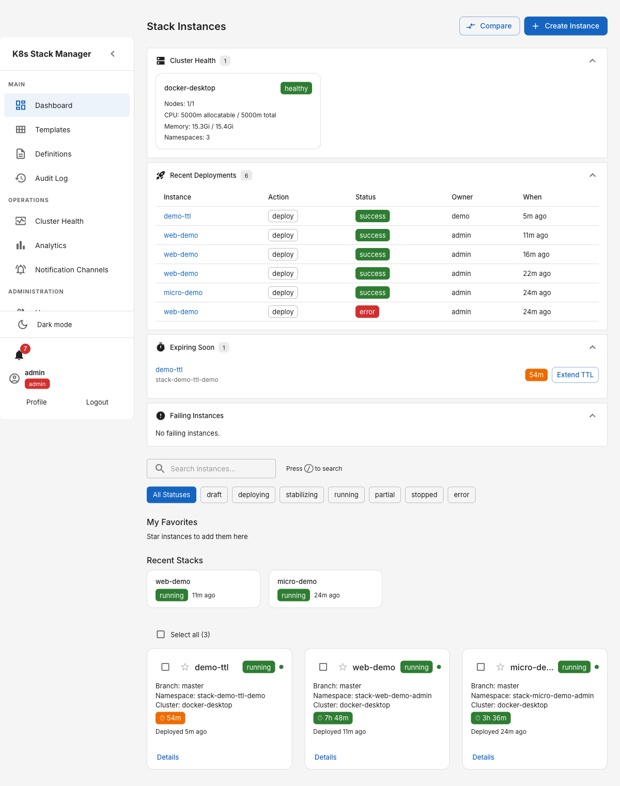
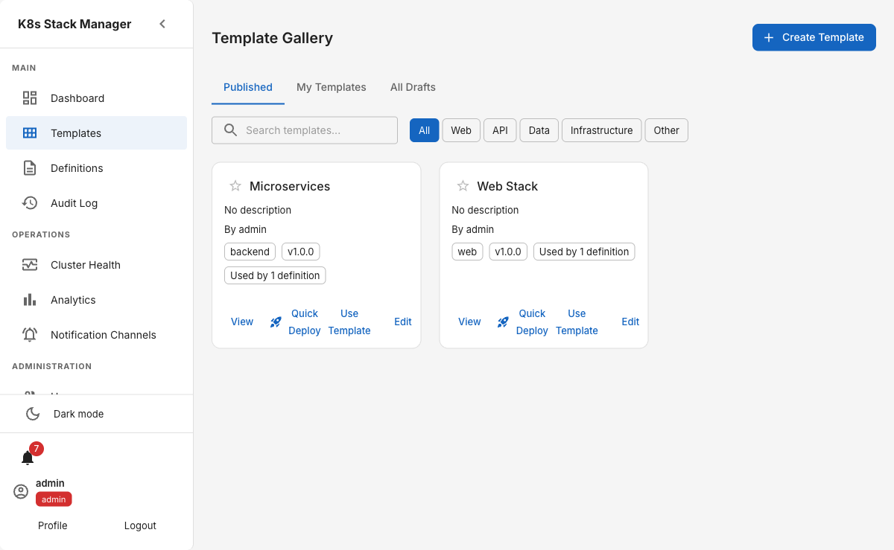
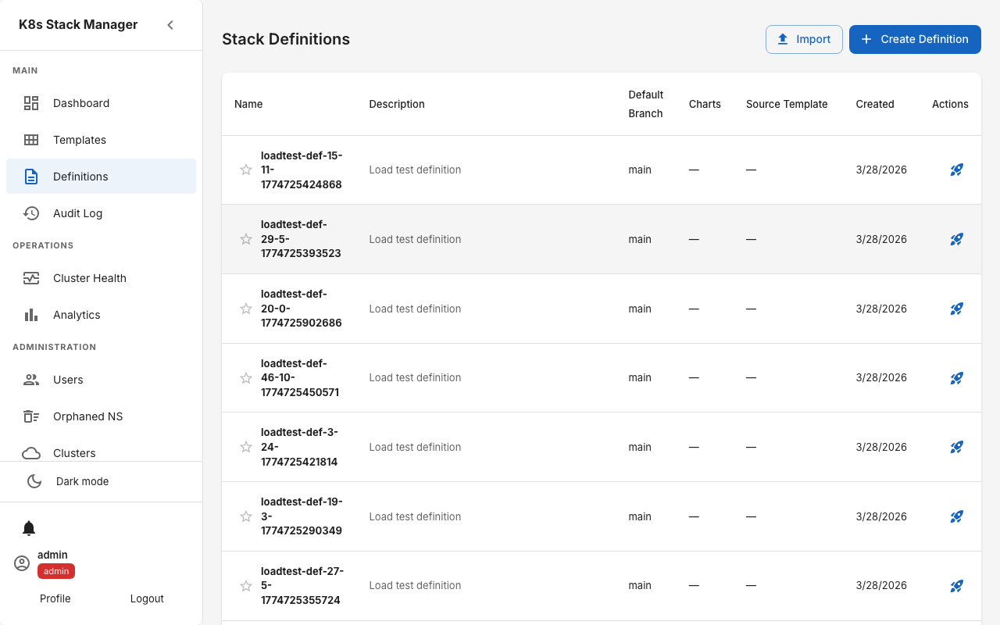
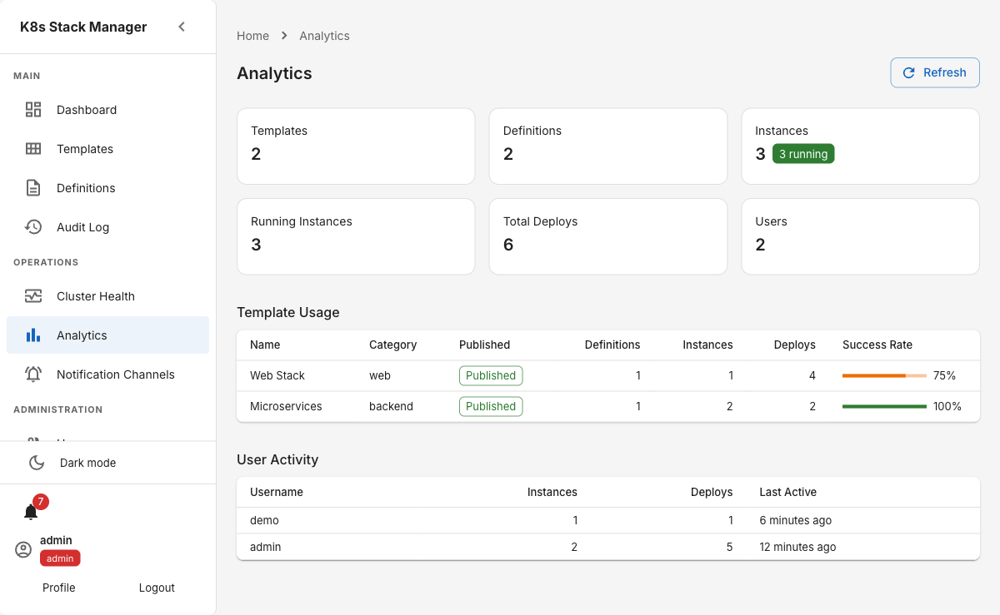
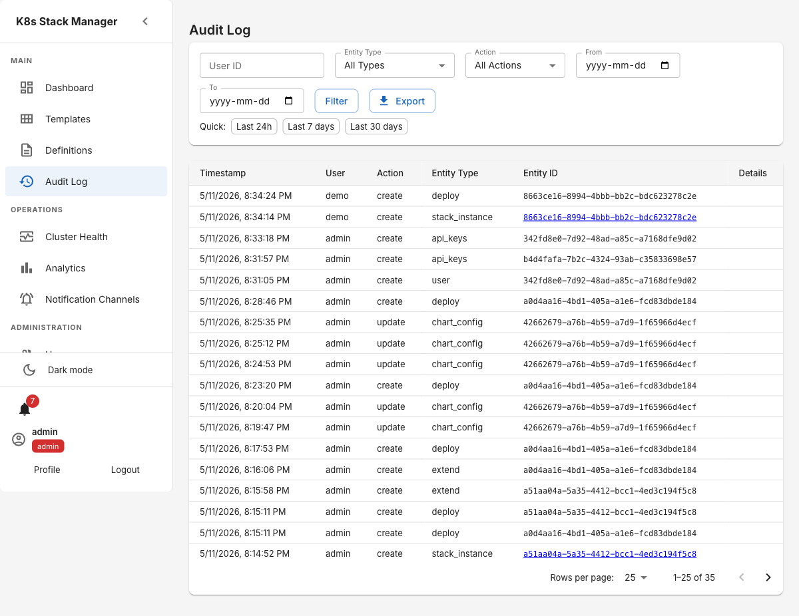
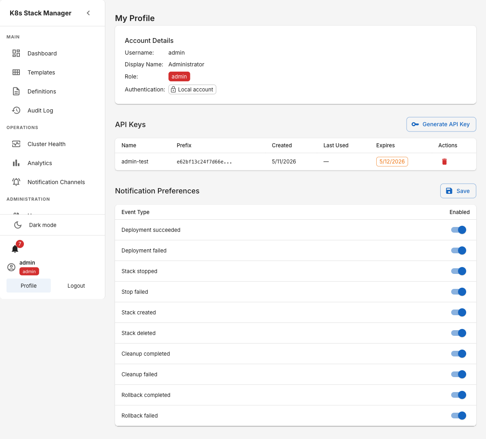

# K8s Stack Manager

K8s Stack Manager is a web application. It configures, stores, and manages multi-service Helm-based application stacks. It deploys them to one or more Kubernetes clusters.

Developers create **stack definitions**. A stack definition is a collection of Helm charts with configuration. Developers then start **stack instances**. A stack instance is a per-developer copy with its own branch and value overrides. The application records every change in an audit log and integrates with Git providers.

## Getting Started

Deploy the application to your cluster and create your first stack in about 10 minutes.

```bash
# Install the CLI
brew install --cask omattsson/tap/stackctl

# Add the Helm repo
helm repo add k8s-stack-manager https://omattsson.github.io/k8s-stack-manager
helm repo update

# Deploy to your cluster (see docs/getting-started.md for the secrets setup)
helm install stack-manager k8s-stack-manager/k8s-stack-manager \
  --namespace stack-manager --create-namespace \
  --values stack-manager-values.yaml
```

Read the [Getting Started guide](docs/getting-started.md) for the next steps. It shows how to configure stackctl, register a cluster, import the [starter definitions](examples/starter-templates/), and deploy your first stack.

Note: If you do not need the web UI, go to the [Headless / API-only deployment](#headless--api-only-deployment) section. stackctl drives every workflow.

## Features

### Dashboard: Stack Instance Management

Use the dashboard to view, search, and manage all your stack instances. You can:

- Filter the list by status: `draft`, `deploying`, `stabilizing`, `running`, `partial`, `stopped`, or `error`.
- Mark favorites with a star and see the recently used stacks.
- Select instances and deploy, stop, clean, or delete up to 50 of them in one request. This needs the `devops` or `admin` role.



### Template Gallery

Browse reusable stack templates. Filter them by category: Web, API, Data, Infrastructure, or Other. Each template has a description and a version.

- **Quick Deploy** creates a new instance from a template and deploys it with one click.
- Users with the `devops` or `admin` role create templates and publish them. A published template is a snapshot (a version). Users always get the latest snapshot.



### Stack Definitions

A stack definition describes a multi-chart application. It has Helm chart configurations, a default branch, and value templates. You can import and export a definition as a JSON bundle.

Users with the `user` role get definitions from templates. Users with the `devops` or `admin` role also create and import definitions (see [Roles and security model](#roles-and-security-model)).



### Analytics Dashboard

The analytics page shows the number of templates, definitions, instances, running instances, deployments, and users. A table shows the deployments and the success rate of each template. Users with the `devops` or `admin` role can open the page. Only the `admin` role gets the per-user statistics.



### Audit Log

The audit log records every change that a user makes through the API: creates, updates, deletes, and operations such as deploy, stop, or role change. Filter the log by user ID, entity type, entity ID, action, and date range.

Only `devops` and `admin` users can read the audit log. Only `admin` users can export it.



### User Profile and API Keys

On the profile page, you manage your account, create API keys for CI/CD automation, and set notification preferences for each event type.



### Additional Features

- **Multi-cluster support.** Register more than one Kubernetes cluster. Kubeconfig data is encrypted at rest with AES-GCM (Advanced Encryption Standard, Galois/Counter Mode). A cluster can also use the service account of the backend (`use_in_cluster`). The application monitors the health and the resource use of each cluster.
- **Git provider integration.** The application lists branches from Azure DevOps and GitLab repositories (`gitlab.com`, or the host of `GITLAB_BASE_URL`). You can set a branch for each chart.
- **Helm values deep merge.** Chart defaults merge with instance overrides. The application replaces template variables (`{{.Branch}}`, `{{.Namespace}}`, `{{.InstanceName}}`, `{{.StackName}}`, `{{.Owner}}`) in the values.
- **Deploy preview and rollback.** See the merged values before you deploy. Roll back one revision, or roll back to the values of an earlier successful deploy.
- **Resource quotas.** Set a ResourceQuota and a LimitRange for the stack namespaces of a cluster. You can set an override for one instance.
- **Cleanup policies.** Run cron-based actions (stop, clean, delete) on instances that match a condition.
- **TTL auto-expiry.** Set a time to live (TTL) on an instance. A background worker stops the instance when the TTL ends.
- **Real-time updates.** WebSocket messages send deployment status changes to all connected clients.
- **Role-based access control (RBAC).** The roles are `admin`, `devops`, and `user`. Authentication uses JSON Web Tokens (JWT), API keys, and optional OpenID Connect (OIDC) single sign-on (SSO).
- **Notifications.** Users get in-app notifications for deploy, stop, and clean events. `devops` and `admin` users can send events to webhook channels.
- **Instance comparison.** Compare two instances side by side, with the merged Helm values of each chart.
- **Shared values.** Set Helm values for a whole cluster. The application merges them by priority before the instance values.
- **Branding.** Set the product name, the logo, and the favicon (see [Branding](WIKI.md#branding)).
- **Dark mode.** The UI has a light theme and a dark theme.

### Extending: bring your own operations

The core application contains no organization-specific logic. You add database refreshes, CMDB sync, policy gates, snapshots, or chat notifications without a fork. You write each of them as a small service outside of the application, in any language.

There are two mechanisms:

- **Event hooks.** The application sends HTTP POST requests to subscribers on lifecycle events (`pre-deploy`, `post-instance-create`, and others). A subscriber with `failure_policy: fail` can stop an operation, for example to enforce a policy.
- **Actions.** `POST /api/v1/stack-instances/:id/actions/:name` sends a request to a subscriber that you register. The application returns the answer of the subscriber to the caller. stackctl can show actions as subcommands through [plugin discovery](https://github.com/omattsson/stackctl/blob/main/EXTENDING.md).

Both mechanisms use plain HTTP with HMAC (hash-based message authentication code) signing. See the examples in Python ([backend/examples/webhook-handler-python/](backend/examples/webhook-handler-python/)) and in Go ([backend/examples/webhook-handler/](backend/examples/webhook-handler/)).

Read [EXTENDING.md](EXTENDING.md) for the tutorial, the event reference, the action contract, and the security notes.

## Roles and security model

The application has three roles. Each role includes the rights of the roles below it: `admin` includes `devops`, and `devops` includes `user`.

| Role | Main rights |
|---|---|
| `user` | Use templates (Use Template, Quick Deploy). Create instances. Deploy, stop, clean, and delete own instances. Change the names, values, and branches of own definitions. |
| `devops` | Everything of `user`. Create templates. Change, publish, and delete own templates (an `admin` can do this for all templates). Create, import, and export definitions, and add or remove charts. Operate all instances, and use bulk operations. Read the audit log, analytics, and cluster health. Manage notification channels. |
| `admin` | Everything of `devops`. Manage clusters, quotas, shared values, users, API keys of other users, cleanup policies, and orphaned namespaces. Export the audit log. |

Security controls of the application:

- **Instance access.** Only the owner, `admin` users, and `devops` users can change or operate an instance. Other users see it read-only. See [Stack instance permissions](WIKI.md#stack-instance-permissions).
- **Definition access.** Only `devops` and `admin` users can create or import a definition, and add or remove charts. A user without these roles cannot change the chart name, repository, path, or version. The owner, `devops`, and `admin` can change or delete a definition.
- **Chart source allowlist.** Helm installs charts with the identity of the backend. Set `ALLOWED_CHART_REPOS` (Helm value `backend.allowedChartRepos`) to a list of chart repository URL prefixes. The backend then rejects all other chart sources when a chart config is saved and again at deploy time. An empty list allows every chart source. Set the list on every cluster that untrusted users can deploy to. See [Chart sources](WIKI.md#chart-sources).
- **Namespace-scoped RBAC.** With `backend.rbac.scope: namespace` (default), the Helm chart gives the backend namespaced rights only inside stack namespaces. A stack chart cannot read or change objects in other namespaces, and cannot create cluster-scoped objects. A ValidatingAdmissionPolicy (Kubernetes 1.30 or later) keeps the backend inside stack namespaces. See [Backend rights on the cluster](WIKI.md#backend-rights-on-the-cluster).
- **Sessions and tokens.** Access tokens are short-lived. Refresh tokens rotate. You can revoke users and sessions. See [Sessions](WIKI.md#sessions).
- **Secrets at rest.** Kubeconfig data, registry passwords, and webhook channel secrets are encrypted with a key that the application derives from `KUBECONFIG_ENCRYPTION_KEY`.
- **HTTP hardening.** The application sets security headers and rate limits, and has panic recovery. The Gin framework runs in release mode unless you set `APP_DEBUG=true` or `GIN_MODE`.

Warning: The default value of `CORS_ALLOWED_ORIGINS` is `*`. Set it to the origin of your UI for production.

## Architecture

```
Frontend (React + MUI + TypeScript)
        |
        v
Backend (Go + Gin)
  |-- REST API with JWT and API-key auth
  |-- MySQL (GORM)
  |-- Git providers (Azure DevOps + GitLab)
  |-- Helm values (deep merge + template substitution)
  |-- Multi-cluster support (kubeconfig encrypted at rest)
  |-- Hooks and actions (HTTP, HMAC signed)
  `-- Audit logging
```

See [ARCHITECTURE.md](ARCHITECTURE.md) for details.

## Quick Start (development)

### Prerequisites

- Docker and Docker Compose
- Go 1.26 or later (for local backend development)
- Node.js 22.12 or later (for local frontend development). CI and the Docker images use Node.js 26.
- MySQL 8.0 or later for an external database. Docker Compose uses MySQL 8.4. The MySQL in the Helm chart uses image tag `8.0` by default.

### Start with Docker Compose

```bash
cp .env.example .env   # first time only; sets COMPOSE_PROFILES=full
make dev
```

This command starts these services:

- **Frontend**: http://localhost:3000
- **Backend API**: http://localhost:8081
- **Swagger docs**: http://localhost:8081/swagger/index.html

The default admin credentials are `admin` / `admin`. These are the defaults of `docker-compose.yml`. Use them for local development only.

Note: The Swagger UI is on only when `ENABLE_SWAGGER=true`. Docker Compose sets it to `true`. The default of the backend and of the Helm chart is `false`.

### Start locally (without Docker for the application)

```bash
# Start MySQL, the backend, and the frontend with hot reload in one terminal.
make dev-local

# Or run them in separate terminals:
make mysql-start           # MySQL in Docker; dev-local-backend does not start it
make dev-local-backend     # backend (uses "air" for hot reload when installed)
cd frontend && npm install && npm run dev
```

## Headless / API-only deployment

K8s Stack Manager works without the React UI. The REST API drives every workflow of the dashboard. [stackctl](https://github.com/omattsson/stackctl) is the supported headless client. The options below are independent.

### Why run headless?

- CI/CD pipelines drive deploys, stops, and rollbacks with `stackctl`.
- Air-gapped environments do not need the web UI.
- The installation uses fewer resources: one Deployment less, and no nginx.
- Preview environments start faster.

The frontend authenticates against the backend in the same way as the CLI. When you remove it, you lose no backend function.

### Docker Compose

```bash
# The Makefile target sets the profile for you
make compose-api-only

# Or set the profile with an environment variable (works with any compose subcommand)
COMPOSE_PROFILES=api-only docker compose up
```

`docker-compose.yml` puts the frontend service in the profile `full`. The service runs only when that profile is active. `.env.example` sets `COMPOSE_PROFILES=full`. Remove it or change it to run headless.

Note: If you have an old `.env` file without `COMPOSE_PROFILES=full`, add that line. Otherwise `docker compose up` starts the headless stack. `make dev` and `make prod` always use `--profile full`.

### Helm chart

Set `frontend.enabled=false`. The chart then renders no frontend resources (Deployment or Rollout, Service, ConfigMap, HPA, PDB, ServiceAccount) and no ingress rule for `/`. The backend routes (`/api`, `/ws`, `/health`, `/swagger`) stay.

```bash
# Install from the published Helm repo.
# Use the local chart path helm/k8s-stack-manager only when you have a
# repository checkout, for example for chart development.
helm install stack-manager k8s-stack-manager/k8s-stack-manager \
  --namespace stack-manager --create-namespace \
  --set backend.secrets.JWT_SECRET=my-secret-at-least-16-chars \
  --set frontend.enabled=false \
  --set ingress.host=stacks.example.com
```

### stackctl CLI

When the API is reachable, install stackctl and point it at the API:

```bash
# Install
brew install --cask omattsson/tap/stackctl

# Create a context and point it at the backend
stackctl config use-context my-cluster
stackctl config set api-url https://stacks.example.com
stackctl login            # asks for the username and password
# Or, when your installation has OIDC configured:
stackctl login --sso      # opens a browser (RFC 8252 loopback flow)
```

`stackctl login --sso` uses the OIDC loopback flow. These steps run:

1. The CLI calls the `cli-auth` endpoint of the backend.
2. The CLI opens the returned `login_url` in your default browser.
3. The CLI starts a local HTTP server on `127.0.0.1:<random-port>`.
4. You sign in at the identity provider.
5. The backend redirects the browser (HTTP 302) to the local server of the CLI, with the tokens in the query string.

You do not copy any token. The CLI does not poll, and the frontend is not involved.

After you sign in, each API operation has a CLI command:

```bash
stackctl template list
stackctl stack deploy my-app
stackctl stack watch --id <instance-id>    # real-time WebSocket events
stackctl audit log export --format csv --output-file audit.csv
```

See the [stackctl README](https://github.com/omattsson/stackctl) for all commands.

## Commands

| Command | Description |
|---|---|
| `make dev` | Start the full stack with Docker Compose |
| `make dev-k8s` | Start the full stack with access to a local Kubernetes cluster (Docker Desktop, Rancher Desktop) |
| `make dev-otel` | Start the full stack and the OpenTelemetry stack (Grafana on port 3001, Prometheus on port 9090) |
| `make compose-api-only` | Start the backend and MySQL only (headless) |
| `make dev-api-only` | Same as `compose-api-only`, with development settings |
| `make dev-local` | Run MySQL (Docker), and the backend and frontend locally |
| `make mysql-start` | Start the MySQL container |
| `make seed` | Add sample data to a running dev stack |
| `make test` | Run all unit tests (backend and frontend) |
| `make test-backend` | Run the backend unit tests |
| `make test-frontend` | Run the frontend unit tests |
| `make test-backend-all` | Run the backend unit and integration tests (starts MySQL) |
| `make test-e2e` | Run the end-to-end Playwright tests (starts MySQL and the backend) |
| `make docs` | Regenerate the Swagger documentation |
| `make fmt` | Format the backend and frontend code |
| `make lint` | Lint the backend (`go vet`) and the frontend |
| `make clean` | Stop the containers and remove the volumes (this deletes the database) |
| `make install` | Install all dependencies |
| `make helm-lint` | Lint the Helm chart |
| `make helm-template` | Render the templates locally (dry run) |
| `make helm-test` | Check the default render and the External Secrets render |
| `make helm-install` | Install the chart into the current cluster (needs `JWT_SECRET`) |
| `make helm-upgrade` | Upgrade an existing release (needs `JWT_SECRET`) |
| `make helm-uninstall` | Uninstall the release |
| `make loadtest` | Run the load tests (see [loadtest/README.md](loadtest/README.md)) |

## Project Structure

```
backend/                        Go API server
  api/                          Entry point (main.go) and bootstrap
  internal/
    api/                        Handlers, middleware, routes
    auth/                       OIDC provider (PKCE)
    cache/                      In-memory TTL cache
    cluster/                    Multi-cluster registry, health poller, quota and secret monitors
    config/                     Environment-based configuration
    database/                   Repositories and migrations
    deployer/                   Helm CLI wrapper for deploy, stop, clean, rollback
    gitprovider/                Azure DevOps and GitLab integration
    health/                     Liveness and readiness checks
    helm/                       Values merge and template substitution
    hooks/                      Outbound lifecycle hooks and custom actions
    k8s/                        Cluster client, status watcher, quotas
    leader/                     Leader election (Kubernetes Lease)
    models/                     Domain models and interfaces
    notifier/                   In-app notifications and notification channels
    replica/                    Replica identity and heartbeat
    scheduler/                  Cron-based cleanup policy execution
    sessionstore/               Token blocklist and OIDC state
    telemetry/                  OpenTelemetry setup and metrics
    ttl/                        TTL reaper for expired instances
    websocket/                  Real-time event hub and fan-out
  pkg/                          crypto (AES-GCM), dberrors, utils
  docs/                         Swagger / OpenAPI (generated)
  examples/                     Webhook handler examples (Go, Python)
frontend/                       React single-page application
  src/
    api/                        API client and types
    components/                 Shared UI components
    context/                    Auth, branding, notification, and theme contexts
    hooks/                      WebSocket and utility hooks
    pages/                      Page components
    routes.tsx                  Route definitions
helm/k8s-stack-manager/         Helm chart
  templates/backend/            Backend workload, services, configuration, RBAC
  templates/frontend/           Frontend workload, services, nginx configuration
  templates/traefik/            Traefik IngressRoute and middleware
  templates/mysql/              Bundled MySQL
  templates/otel/               OpenTelemetry collector
  templates/external-secrets/   External Secrets Operator resources
examples/starter-templates/     Starter definition bundles
infra/                          Infrastructure examples
loadtest/                       Load tests (k6 and Playwright)
docs/                           Guides and screenshots
docker-compose.yml              Local development stack
```

## API Overview

Swagger documents all routes. All routes need authentication, except `/health/*`, `/api/v1/ping`, `/api/v1/ui-config`, the login, refresh, logout, and OIDC routes, and the Items routes (`/api/v1/items`). The Items routes are the reference implementation of a CRUD handler. The web UI does not use them.

| Group | Prefix | Description |
|-------|--------|-------------|
| Auth | `/api/v1/auth` | Login, register, current user, refresh, logout, logout-all |
| OIDC | `/api/v1/auth/oidc` | OIDC configuration, authorize, callback, CLI login |
| Templates | `/api/v1/templates` | Template CRUD, publish, unpublish, instantiate, clone, versions, bulk operations |
| Quick Deploy | `/api/v1/templates/:id/quick-deploy` | One-click template deployment |
| Definitions | `/api/v1/stack-definitions` | Definition CRUD, chart configs, import, export, upgrade |
| Instances | `/api/v1/stack-instances` | Instance CRUD, clone, deploy, deploy preview, stop, clean, rollback, status, logs, compare, extend TTL, follow, custom actions, bulk operations |
| Overrides | `/api/v1/stack-instances/:id/overrides` | Per-chart value overrides |
| Branch Overrides | `/api/v1/stack-instances/:id/branches` | Per-chart branch overrides |
| Quota Overrides | `/api/v1/stack-instances/:id/quota-overrides` | Per-instance resource quota override |
| Git | `/api/v1/git` | Branch listing, validation, provider status |
| Audit Logs | `/api/v1/audit-logs` | Filterable audit trail (`devops` or `admin`) and export (`admin`) |
| Users | `/api/v1/users` | User management (`admin`): list, delete, disable, enable, password reset, role change |
| API Keys | `/api/v1/users/:id/api-keys` | API key management |
| Admin | `/api/v1/admin` | Orphaned namespaces (`admin`), notification channels (`devops`) |
| Cleanup Policies | `/api/v1/admin/cleanup-policies` | Cron-based cleanup policy management (`admin`) |
| Clusters | `/api/v1/clusters` | Cluster registration, health, test connection, quotas, utilization |
| Shared Values | `/api/v1/clusters/:id/shared-values` | Per-cluster shared Helm values (`admin`) |
| Analytics | `/api/v1/analytics` | Usage overview and template statistics (`devops`), user statistics (`admin`) |
| Dashboard | `/api/v1/dashboard` | Overview for the landing page |
| Notifications | `/api/v1/notifications` | List, mark read, count, preferences |
| Favorites | `/api/v1/favorites` | Bookmarks |
| UI Config | `/api/v1/ui-config` | Public branding values |
| Health | `/health/*` | Liveness and readiness |
| WebSocket | `/ws` | Real-time status and log events |

## Configuration

The table shows the key environment variables. The full list is in `backend/internal/config/config.go`, `docker-compose.yml`, and the Helm chart `values.yaml`.

| Variable | Required | Description |
|---|---|---|
| `JWT_SECRET` | Yes | JWT signing secret (minimum 16 characters) |
| `ADMIN_USERNAME` | No | Username of the initial admin user (default: `admin`) |
| `ADMIN_PASSWORD` | Yes | Password of the initial admin user. The backend creates the user at startup when it does not exist. |
| `SELF_REGISTRATION` | No | Let any signed-in user register new `user` accounts (default: `false`; the Helm chart and Docker Compose set `true`). With `false`, only `admin` users register users. |
| `OIDC_ENABLED` and `OIDC_*` | No | OpenID Connect single sign-on. See [OIDC single sign-on](WIKI.md#authentication). |
| `DB_HOST`, `DB_PORT`, `DB_USER`, `DB_PASSWORD`, `DB_NAME` | No | MySQL connection. Set them for your database (defaults: `localhost`, `3306`, `root`, empty, `app`). The Helm chart sets them for the bundled MySQL. |
| `AZURE_DEVOPS_PAT` | No | Azure DevOps personal access token (PAT) |
| `AZURE_DEVOPS_AUTH` | No | `pat` (default) or `workload-identity`. With `workload-identity`, the backend lists Azure DevOps branches with an Entra ID token from `AZURE_CLIENT_ID`, `AZURE_TENANT_ID`, and `AZURE_FEDERATED_TOKEN_FILE`, not with a PAT. |
| `GITLAB_TOKEN` | No | GitLab access token |
| `DEFAULT_BRANCH` | No | Default Git branch (default: `master`) |
| `KUBECONFIG_ENCRYPTION_KEY` | No | Passphrase. The backend derives an AES-256 key from it (SHA-256) to encrypt kubeconfig data, registry passwords, and webhook channel secrets. Without it, the backend rejects a cluster that has kubeconfig data. Use a kubeconfig path or in-cluster configuration then. |
| `ALLOWED_CHART_REPOS` | No | Comma-separated chart repository URL prefixes (`oci://`, `https://`, `http://`). Empty: every chart source is allowed. |
| `NAMESPACE_LABELS` | No | Extra labels for stack namespaces (`key=value,key=value`) |
| `CORS_ALLOWED_ORIGINS` | No | Allowed CORS origins (default: `*`) |
| `RATE_LIMIT` / `LOGIN_RATE_LIMIT` | No | Requests per minute for each IP address (defaults: `100` / `10`) |
| `ENABLE_SWAGGER` | No | Serve the Swagger UI at `/swagger` (default: `false`) |
| `SESSION_STORE` | No | Session store backend: `mysql` (default) or `memory` |
| `ACCESS_TOKEN_EXPIRATION` | No | Lifetime of an access token (default: `15m`) |
| `SESSION_IDLE_TIMEOUT` | No | End a session after this time without requests (default: `30m`) |
| `SESSION_MAX_LIFETIME` | No | Maximum session time from login. A refresh does not extend it (default: `12h`) |
| `REFRESH_REUSE_GRACE` | No | A just-rotated refresh token still gets an access token for this time. This supports refreshes from several browser tabs. `0` disables it (default: `30s`). |
| `SECURE_COOKIES` | No | Set the `Secure` flag on the refresh-token cookie. Use `true` behind HTTPS (default: `false`). The Helm chart sets `true` when the ingress has TLS. |
| `LEADER_ELECTION_ENABLED` | No | Elect one replica (Kubernetes Lease) to run the background workers. Needs the in-cluster service account. Default: `false`, which means this process always runs the workers. The Helm chart sets `true`. |
| `LEADER_ELECTION_LEASE_NAME` | No | Name of the Lease (default: `k8s-stack-manager-workers`) |
| `LEADER_ELECTION_NAMESPACE` | No | Namespace of the Lease (default: `POD_NAMESPACE`, else the namespace of the service account) |
| `LEADER_ELECTION_LEASE_DURATION`, `LEADER_ELECTION_RENEW_DEADLINE`, `LEADER_ELECTION_RETRY_PERIOD` | No | Election timings (defaults: `15s`, `10s`, `2s`) |
| `WS_FANOUT_ENABLED` | No | Share WebSocket messages between replicas through the `ws_events` table (default: `false`). The Helm chart sets `true`. |
| `WS_FANOUT_POLL_INTERVAL`, `WS_FANOUT_RETENTION` | No | Poll interval and row retention of the fan-out (defaults: `500ms`, `5m`) |
| `APP_TITLE` | No | Product name in the browser tab, sidebar, app bar, login page, and setup wizard (default: `K8s Stack Manager`, maximum 100 characters) |
| `APP_LOGO_URL` | No | Logo image: a same-origin path (`/branding/logo.svg`) or an `https://` URL (default: empty, which means the built-in logo) |
| `APP_FAVICON_URL` | No | Browser tab icon. The same URL rule applies (default: `/favicon.svg`). Other schemes (`http:`, `javascript:`, `data:`) stop the startup with an error. |

See [Sessions](WIKI.md#sessions) for the way the session limits work together. See [Branding](WIKI.md#branding) for the branding settings (Helm values `branding.*`).

## Helm Chart (Kubernetes Deployment)

The Helm chart in `helm/k8s-stack-manager/` deploys the backend, the frontend, and (optional) a bundled MySQL and an OpenTelemetry collector. The chart has these options:

- **Workload kind.** The chart creates Deployments by default. Set `argoRollouts.enabled=true` to create Argo Rollouts with a canary strategy (20%, 50%, 80%) instead.
- **Ingress type.** `ingress.type` is `traefik` (default), `ingress` (a standard Ingress for any controller), or `none` (use port-forward).
- **Secrets.** Secrets come from a chart Secret or from the External Secrets Operator.

### Prerequisites

- A Kubernetes cluster with a configured `kubectl` context. Kubernetes 1.30 or later is needed for the default ValidatingAdmissionPolicy (`backend.rbac.admissionPolicy.enabled`).
- Helm 3 or later.
- MySQL 8.0 or later, when you set `mysql.enabled=false` (external database).
- [Traefik](https://traefik.io/) with its CRDs, because the default `ingress.type` is `traefik`. If you do not use Traefik, set `ingress.type=ingress` or `ingress.type=none`.
- The [Argo Rollouts](https://argoproj.github.io/argo-rollouts/) controller, only when `argoRollouts.enabled=true`. Weight-based traffic splitting also needs `ingress.type=traefik`.
- The [External Secrets Operator](https://external-secrets.io/), only when `externalSecrets.enabled=true`.

### Install

Note: The chart needs a value for `backend.secrets.JWT_SECRET` when it renders. Set it with `--set`, with a values file, or with the `JWT_SECRET` environment variable for the `make` targets. The `make helm-install` and `make helm-upgrade` targets stop when `JWT_SECRET` is not set.

```bash
# Lint the chart
make helm-lint

# Install (the JWT_SECRET environment variable is required)
JWT_SECRET=my-secret-at-least-16-chars make helm-install

# Or install with custom values
helm install k8s-stack-manager helm/k8s-stack-manager \
  --namespace k8s-stack-manager --create-namespace \
  --set backend.secrets.JWT_SECRET=my-secret-at-least-16-chars \
  --set ingress.host=stacks.example.com

# Upgrade after a change
JWT_SECRET=my-secret-at-least-16-chars make helm-upgrade

# Uninstall
make helm-uninstall
```

Warning: Change the placeholder values `backend.secrets.ADMIN_PASSWORD` and `mysql.auth.rootPassword`. Change `backend.env.CORS_ALLOWED_ORIGINS` (default `*`) to the origin of your UI. The notes after `helm install` warn you about each placeholder.

Note: The chart sets `SELF_REGISTRATION` to `true`. Any signed-in user can then register new `user` accounts. Set `backend.env.SELF_REGISTRATION` to `"false"` to allow only `admin` users to register users.

### Security settings of the chart

| Value | Default | Effect |
|---|---|---|
| `backend.allowedChartRepos` | `[]` | Chart repository URL prefixes that definitions and templates may use. Empty allows every chart source. |
| `backend.rbac.scope` | `namespace` | `namespace`: the backend has namespaced rights only in stack namespaces (RoleBinding `k8s-stack-manager-access`). `cluster`: the namespaced rights apply in all namespaces (the rules of chart 0.6 and earlier). Use `cluster` only when stack charts need cluster-scoped objects. |
| `backend.rbac.admissionPolicy.enabled` | `true` | Create a ValidatingAdmissionPolicy that limits the backend to stack namespaces (Kubernetes 1.30 or later). |
| `backend.namespaceLabels` | `{}` | Extra labels on stack namespaces, for example Pod Security Admission levels. |
| `ingress.traefik.priority` | `10000` | Traefik router priority of all IngressRoute routes. A high value stops another Ingress on the same host from taking a path of the stack manager. The frontend route gets this value minus 1. `0` uses the Traefik default. |

See [Backend rights on the cluster](WIKI.md#backend-rights-on-the-cluster) and [Chart sources](WIKI.md#chart-sources) for details.

### External Secrets Operator with Azure Key Vault

Set `externalSecrets.enabled=true`. The [External Secrets Operator (ESO)](https://external-secrets.io/) then creates the backend Secret from Azure Key Vault. In this mode the chart does not render its inline backend Secret. ESO creates the Secret `<fullname>-backend`, which the backend workload uses.

- When the bundled MySQL is on, ESO also creates the MySQL Secret with `MYSQL_ROOT_PASSWORD`. If `mysql.auth.user` is not empty, ESO also needs `MYSQL_PASSWORD`. The chart maps both keys only to the MySQL Secret.
- The backend `DB_PASSWORD` comes from the MySQL credential mapping: `MYSQL_PASSWORD` when `mysql.auth.user` is set, else `MYSQL_ROOT_PASSWORD`.

Before you install:

1. Install ESO with its `external-secrets.io/v1` CRDs.
2. Give the Azure identity read access to the Key Vault secrets.
3. Configure AKS workload identity.
4. For the `SecretStore` that the chart creates, create a federated identity credential for the managed identity. Use the subject `system:serviceaccount:<namespace>:<fullname>-backend`. `<fullname>` is the rendered fullname of the chart.

The fullname for a release called `stack-manager` is `stack-manager-k8s-stack-manager`. When the release name already contains `k8s-stack-manager`, the chart uses the release name. `fullnameOverride` replaces the fullname. The chart adds the annotation `azure.workload.identity/client-id` to the ServiceAccount.

```yaml
# external-secrets-values.yaml
externalSecrets:
  enabled: true
  azureKeyVault:
    vaultUrl: https://my-vault.vault.azure.net
    tenantId: 00000000-0000-0000-0000-000000000000
    authType: WorkloadIdentity
    workloadIdentity:
      clientId: 00000000-0000-0000-0000-000000000000
  data:
    - secretKey: JWT_SECRET
      remoteRef:
        key: k8s-stack-manager-jwt-secret
    - secretKey: ADMIN_PASSWORD
      remoteRef:
        key: k8s-stack-manager-admin-password
    - secretKey: MYSQL_ROOT_PASSWORD
      remoteRef:
        key: k8s-stack-manager-mysql-root-password
    - secretKey: MYSQL_PASSWORD
      remoteRef:
        key: k8s-stack-manager-mysql-password
```

```bash
helm upgrade --install k8s-stack-manager helm/k8s-stack-manager \
  --namespace k8s-stack-manager --create-namespace \
  --values external-secrets-values.yaml
```

Rules for `externalSecrets.data`:

- Each entry maps a Key Vault secret to an environment key. `JWT_SECRET` is required.
- With `mysql.enabled=true`, the chart needs `MYSQL_ROOT_PASSWORD`. It also needs `MYSQL_PASSWORD` when `mysql.auth.user` is not empty.
- With `mysql.enabled=true`, do not add `DB_PASSWORD`. The chart derives it from the MySQL mapping.
- With `mysql.enabled=false`, add a `DB_PASSWORD` entry with a `remoteRef` to the password of the external database:

```yaml
externalSecrets:
  data:
    - secretKey: DB_PASSWORD
      remoteRef:
        key: k8s-stack-manager-external-db-password
```

- Do not put Key Vault values or Azure credentials in the values file.

To use a store that another team manages, set `externalSecrets.secretStore.create=false`, `externalSecrets.secretStore.kind=ClusterSecretStore` (or `SecretStore`), and `externalSecrets.secretStore.name`. The chart then creates only the `ExternalSecret`. It does not configure the Azure authentication, and it does not annotate the ServiceAccount.

To use a service principal for a store that the chart creates, set `authType: ServicePrincipal`. Set `externalSecrets.azureKeyVault.servicePrincipal.secretName` to an existing Kubernetes Secret. The Secret must contain the keys `client-id` and `client-secret`. Set `clientIdKey` and `clientSecretKey` in the same block when your keys have other names.

### What the chart deploys

- **Backend.** A Deployment and a Service. With `argoRollouts.enabled=true`, the chart creates an Argo Rollout (canary steps 20%, 50%, 80%), a stable Service, and a canary Service instead. The chart also creates a ServiceAccount with RBAC, a PodDisruptionBudget (on by default), and an optional HPA and ServiceMonitor.
- **Frontend.** A Deployment (or an Argo Rollout) with nginx. nginx serves only the React application. The ingress sends the API requests to the backend. You can switch the frontend off with `frontend.enabled=false`.
- **MySQL.** A bundled MySQL (`mysql.enabled`, default `true`). For production, point `backend.env.DB_*` at an external database.
- **Ingress.** With `ingress.type=traefik`, the chart creates an IngressRoute and a Middleware with secure response headers. The IngressRoute sends `/api`, `/ws`, `/health`, and `/swagger` to the backend, and `/` to the frontend. A Middleware that removes the `/api` prefix is optional (`ingress.traefik.middlewares.stripApiPrefix`, default off). With `ingress.type=ingress`, the chart creates a standard Ingress with the same paths.

See `helm/k8s-stack-manager/values.yaml` for all values.

## Testing

```bash
make test                         # All unit tests
make test-backend-all             # Backend unit and integration tests
make test-e2e                     # Playwright end-to-end tests
cd backend && make test-coverage  # Coverage report (80% threshold)
```

## License

See [LICENSE](LICENSE). The project uses the MIT License.
